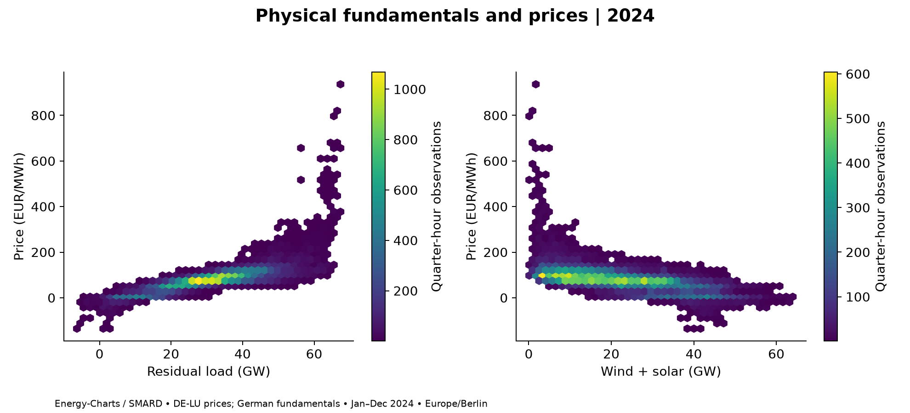

# European Power Market Fundamentals

**How do renewable generation, electricity demand, and cross-border flows relate to negative day-ahead prices and daily price spreads?**

A DE-LU portfolio study targeting the full 2024 calendar year. Spain and Portugal are later extensions.

**Source:** token-free Fraunhofer ISE Energy-Charts API, with DE-LU prices attributed to Bundesnetzagentur | SMARD.de. German load, wind/solar generation and physical border flows are paired with DE-LU prices; this is not a complete DE-LU physical balance.

## Reproduce

Use Python 3.11+ from this repository directory:

```powershell
python -m venv .venv
.\.venv\Scripts\Activate.ps1
python -m pip install -r requirements.txt
# No API token is required.
python -m pytest -q
python -m power_market.run
```

The final command downloads public JSON with metadata and SHA-256 cache verification, validates coverage and writes outputs. Data and credentials are excluded from Git. Dependencies are bounded; record pip freeze with the successful run.

## Deliverables

- power_market/public_data.py: public retrieval, units, geography and provenance; data.py retains the optional legacy ENTSO-E adapter and interval alignment.
- power_market/analysis.py: residual load, daily spreads and negative-price runs.
- power_market/run.py: six charts, coverage/association tables and market report.
- notebooks/fundamentals.ipynb: guided analysis using the modules.
- [Inspection](docs/inspection.md), [data and methods](docs/data-methods.md), [report status](reports/market-report.md).

Charts cover price distribution, seasonality, daily spreads/negative hours, physical fundamentals, flow conditions and three unusual days. Each includes units, dates and source notes. All require validated retrieved data.

## Executed findings — 2024

All required series passed full quarter-hour-grid coverage validation. The executed analysis found **457 negative-price hours (5.20%)**, a longest observed negative-price run of **18 hours**, and a mean daily spread of **EUR 111.20/MWh**. The largest daily spread was **EUR 828.93/MWh on 12 December**.

Price had a descriptive Spearman association of **0.862 with residual load**, **-0.688 with wind plus solar**, and **0.549 with net imports**. These are duration-weighted associations, not causal effects or validated forecasting signals.

[Read the market report](reports/results/market-report.md) · [Coverage](reports/results/coverage.csv) · [Retrieval provenance](reports/results/provenance.json)



## Findings and limitations

Results are written to reports/results/market-report.md, summary.json, associations.csv and six PNG charts after full coverage validation. Residual load is demand minus wind and solar generation. Negative-price exposure informs renewable revenue review; daily ranges screen flexibility opportunities but are not storage profits. Actual fundamentals and flows are ex post; correlations do not identify causal effects or actionable forecasts.

UTC interval alignment preserves daylight-saving changes and different resolutions. Missing observations remain missing; incomplete required series stop report generation. See the methodology for units, source access, rights, border definitions and limitations.

## Preserved work and future scope

Both original notebooks remain intact as historical explorations, and the original README is preserved in docs/legacy-readme.md. Their useful source-query and daily-price ideas informed this implementation. Their unsupported trading claims are superseded. No dashboard or additional model complexity is needed. Spain/Portugal, ex-ante fundamentals and seasonally controlled sensitivity checks are future extensions after DE-LU validation.
